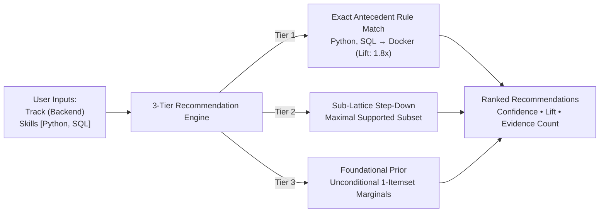

# 🧠 SkillGap: Comprehensive Architecture, Algorithmic Engine & Academic Defense Compendium

> **Audience:** AI agents, software engineers, machine learning researchers, and academic evaluation panels.  
> **Repository:** `Eclatt-Skill-Gap-Analyzer`  
> **Core Algorithm:** ECLAT (Equivalence Class Clustering and bottom-up Lattice Traversal)  
> **Domain:** Information Technology (IT) Career Skill Co-Occurrence & Gap Analysis  
> **Deployment Architecture:** Render (FastAPI REST Server) + Vercel (React 18 SPA) + Google Colab (Notebook)  

---

## 1. Executive Summary & Problem Formulation

### 1.1 The Core Problem
Undergraduate computer science students, boot camp graduates, and self-taught developers frequently suffer from **siloed skill acquisition**: they learn a single programming language (e.g., Python or JavaScript) in isolation without understanding the **companion technologies** that production environments require. When applying for positions, they encounter job postings demanding cohesive tech stacks (e.g., Python paired with PostgreSQL, Docker, and REST APIs).

### 1.2 The System Objective
**SkillGap** is an association rule mining system that uses **ECLAT** to discover natural technology co-occurrences in real-world IT job postings. Given an IT career track (e.g., *Backend Developer*, *Frontend Developer*, *Data Analyst*) and a user's currently possessed skills, the system recommends the most statistically relevant **companion skills** needed to bridge their profile into an employable industry stack.



---

## 2. The 7 Academic Loopholes & Exact Engineering Solutions

During research and defense preparation, the system was subjected to rigorous academic scrutiny. Seven critical vulnerabilities were identified, formulated, and engineered:

### Loophole 1: Seniority Bias in the Dataset vs. Target Population
* **The Limitation:** Available experience labels may be incomplete or inaccurate. The retained entry subset does not establish which technologies are suitable for beginners, and the source-wide seniority distribution is not established here.
* **The Solution:** We implemented **multi-signal seniority partitioning** in `eclat_algorithm/builder.py` and `build_asaniczka.py`:
  1. Metadata check: `job_level` in `["Entry level", "Associate", "Internship"]`.
  2. Title regex: Matching signals like `junior`, `jr`, `intern`, `graduate`, `entry-level`.
  3. Senior title keywords override entry metadata/title signals. Descriptions and years of experience are not read.
* **Result:** `entry` contains records flagged by the heuristic; it is a subset of `all`. A negative entry flag does not prove seniority. Human label validation is pending.

### Loophole 2: Algorithmic Overclaim (Co-occurrence vs. Causality / Pedagogy)
* **The Vulnerability:** ECLAT only mines undirected frequent itemsets and directional conditional probabilities ($P(B|A)$). It cannot mathematically determine pedagogical prerequisites (e.g., whether HTML must be learned before React) or guarantee employment.
* **The Solution:** We explicitly scoped the system interface and terminology:
  - Recommendations are framed strictly as **"Co-occurring Industry Companions"** rather than "Mandatory Prerequisites" or "Guaranteed Pathways".
  - The UI presents metrics with clear definitions: **Confidence** (conditional pairing rate) and **Lift** (strength over baseline frequency).

### Loophole 3: "Why Use ECLAT Instead of COUNT(*)?" (Apriori & Counting Defense)
* **The Vulnerability:** If 70% of backend jobs require Python and 60% require SQL, a simple SQL `SELECT skill, COUNT(*) GROUP BY skill` could suggest the most popular technologies without any data mining algorithm.
* **The Solution:**
  1. **Lift-Driven Dependency:** ECLAT computes $\text{Lift}(A \rightarrow B) = \frac{P(B|A)}{P(B)}$. While COUNT(*) only identifies globally popular tools, Lift surfaces **context-dependent companions**. For example, if a user selects `Pandas`, ECLAT recommends `NumPy` and `Tableau` (high Lift within Data Analyst), whereas a global count would naively suggest `Git` or `Docker` regardless of relevance.
  2. **Empirical Benchmark:** In `eclat_algorithm/evaluation.py`, we use an 80/20 held-out masked-skill evaluation that runs the same capped rule and fallback path as production and compares it with a popularity baseline.

### Loophole 4: Taxonomy Pollution & Wishlist Extraction Errors
* **The Vulnerability:** Job descriptions contain corporate boilerplate, soft skills, benefits, and third-party tools that pollute itemsets (e.g., "communication", "health insurance", "office 365").
* **The Solution:**
  1. **Curated 100+ Skill Taxonomy:** In `eclat_algorithm/taxonomy.py`, we maintained a closed whitelist across 5 functional categories (`Programming Languages`, `Frameworks & Libraries`, `Databases & Storage`, `Cloud & DevOps`, `Architecture & Developer Tools`).
  2. **Boundary-Aware Alias Normalization:** Regex patterns with word-boundaries map aliases (e.g., `postgres` &rarr; `PostgreSQL`, `k8s` &rarr; `Kubernetes`, `react.js` &rarr; `React`).
  3. **Density Threshold:** Ingestion retains at least two canonical skills; masked-skill evaluation uses only records with at least three.

### Loophole 5: Role Definition Scope Creep
* **The Vulnerability:** Modeling too many career paths (Full Stack, QA, Mobile, DevOps, Cloud Architect, Data Engineer) creates extreme data sparsity and classification overlap.
* **The Solution:** We consolidated the system into **3 high-demand, cleanly distinguishable tracks**:
  1. **Backend Developer**
  2. **Frontend Developer**
  3. **Data Analyst**
* A hybrid classifier (`eclat_algorithm.builder.classify_role`) disambiguates generic titles (like "Software Engineer") using the technical stack signature (e.g., React/Vue &rarr; Frontend; Django/Spring/SQL &rarr; Backend; Pandas/Tableau/Power BI &rarr; Data Analyst).

### Loophole 6: Evaluation Scope (Held-Out Masked Recovery)
* **The Vulnerability:** How do we prove the model actually works without real human users?
* **The Solution:** We use an automated **train/test masked-skill recovery** benchmark in `eclat_algorithm/evaluation.py`:
  - 80% of transactions form the training set; 20% are held out as an unseen test set.
  - For each test transaction, exactly one skill is masked at random ($S_{\text{masked}}$).
  - The remaining skills are fed to the model to generate Top-3 and Top-5 recommendations.
  - **Hit-Rate@K** measures whether $S_{\text{masked}} \in \text{Top-K}$.
  - Long-tail cases use each skill's training-set posting frequency ($<30\%$). Results report that subgroup's test count and 95% Wilson intervals; they do not presume ECLAT beats popularity or establish learner usefulness or hiring outcomes.
  - The split is posting-level and randomized; it does not rule out duplicate-posting or employer-level overlap.

### Loophole 7: The Cold Start & Unusual Combinations Problem
* **The Vulnerability:** What happens if a user inputs zero skills, or an atypical combination with zero support in the dataset?
* **The Solution:** A deterministic **3-Tier Recommendation Cascade**:
  - **Tier 1 (Exact Match):** Finds association rules matching the exact user input set.
  - **Tier 2 (Sub-Lattice Step-Down):** Recursively traverses subsets of size $k-1, k-2, \dots, 1$ to find the maximal sub-combination with valid rules.
  - **Tier 3 (Foundational Prior):** Falls back to role-specific 1-itemset frequency marginals, ensuring every user receives actionable advice.

---

## 3. Core Algorithm: ECLAT Implementation Details

### 3.1 Apriori vs. ECLAT
| Dimension | Apriori | ECLAT (Equivalence Class Clustering and bottom-up Lattice Traversal) |
| :--- | :--- | :--- |
| **Data Layout** | **Horizontal**: $\text{TID} \rightarrow \{\text{Item}_1, \text{Item}_2, \dots\}$ | **Vertical**: $\text{Item} \rightarrow \{\text{TID}_1, \text{TID}_2, \dots\}$ |
| **Support Counting** | Repeated full table scans for every candidate set | **Bitwise / Set Intersections** of TID-lists |
| **Search Strategy** | Breadth-First Search (BFS), level by level | **Depth-First Search (DFS)** within prefix equivalence classes |
| **I/O Overhead** | High disk/memory bandwidth for candidate generation | Low: original dataset discarded after TID-list creation |

### 3.2 Mathematical Formulation
1. **Vertical TID-Lists:**
   $$\text{TID}(X) = \{ i \in \{1, \dots, N\} \mid X \subseteq T_i \}$$
2. **Lattice Set Intersection:**
   $$\text{TID}(X \cup Y) = \text{TID}(X) \cap \text{TID}(Y)$$
3. **Support:**
   $$\text{Supp}(X) = \frac{|\text{TID}(X)|}{N}$$
4. **Confidence:**
   $$\text{Conf}(X \rightarrow Y) = \frac{\text{Supp}(X \cup Y)}{\text{Supp}(X)} = \frac{|\text{TID}(X) \cap \text{TID}(Y)|}{|\text{TID}(X)|}$$
5. **Lift:**
   $$\text{Lift}(X \rightarrow Y) = \frac{\text{Conf}(X \rightarrow Y)}{\text{Supp}(Y)} = \frac{N \cdot |\text{TID}(X) \cap \text{TID}(Y)|}{|\text{TID}(X)| \cdot |\text{TID}(Y)|}$$

```
                [Empty Root]
               /     |      \
         Python     SQL      Docker
          /    \     |
   {Python,SQL} {Python,Docker}
         \
     {Python,SQL,Docker}  <-- Formed by TID(Python,SQL) ∩ TID(Docker)
```

---

## 4. Dataset Evolution & Current Production State

### 4.1 From Kaggle 123K to asaniczka 1.3M
* **Initial Dataset:** Kaggle 2024 LinkedIn Job Postings (123,849 raw postings in `data/raw/postings.csv`, 516 MB).
* **Current Production Dataset:** [asaniczka 1.3M+ LinkedIn Jobs and Skills 2024](https://www.kaggle.com/datasets/asaniczka/1-3m-linkedin-jobs-and-skills-2024) (`linkedin_job_postings.csv` + `job_skills.csv`). The original raw files and build manifest are unavailable locally, so the current artifact's source version and source totals cannot be independently verified.

### 4.2 Production Clean Transaction Distribution (`clean_summary.json`)
Streamed and filtered through `eclat_algorithm/scripts/build_asaniczka.py`:

| Role Track | Total Clean Transactions (`all`) | Entry-Level Segment (`entry`) |
| :--- | :--- | :--- |
| **Backend Developer** | 28,388 | 1,724 |
| **Frontend Developer** | 2,520 | 292 |
| **Data Analyst** | 13,533 | 1,438 |
| **Total Retained Records** | **44,441** | **3,454** |
*(44,441 retained heuristic assignments, including 3,454 entry-flagged records. Synthetic IDs do not overlap across tracks because each record receives one primary assignment; this does not validate labels or source deduplication. See [the data audit](../data/README.md).)*

---

## 5. Architectural Map of the Codebase

```
Eclatt-Skill-Gap-Analyzer/
├── 🖥️ server/                         # FASTAPI REST API SERVICE
│   ├── app/
│   │   ├── main.py                    # App entry point, CORS middleware, router registration
│   │   ├── config.py                  # Path resolution (locates data/processed/rules.json)
│   │   ├── schemas/models.py          # Pydantic validation: GapAnalysisRequest, GapRecommendation
│   │   └── routes/
│   │       ├── analyze.py             # POST /api/v1/analyze (3-Tier ECLAT engine controller)
│   │       ├── roles.py               # GET /api/v1/roles (Taxonomy & available roles)
│   │       └── metrics.py             # GET /api/v1/metrics (Hit-Rate@K validation benchmark)
│   ├── requirements.txt               # Server dependencies (fastapi, uvicorn, pydantic)
│   └── README.md
│
├── 🧮 eclat_algorithm/                # MACHINE LEARNING ENGINE
│   ├── miner.py                       # ECLATMiner: TID-lists, DFS lattice, rule derivation, recommend()
│   ├── taxonomy.py                    # Canonical IT skills (100+ entities), alias regex normalizer
│   ├── builder.py                     # Role classification & multi-signal seniority filtering
│   ├── runner.py                      # Precomputes & serializes rules to rules.json
│   ├── evaluation.py                  # Production-path train/test Hit-Rate@K benchmark
│   ├── scripts/                       # CLI commands:
│   │   ├── build_asaniczka.py         # 1.3M dataset streaming ingestion pipeline
│   │   ├── build_dataset.py           # Local postings.csv ingestion pipeline
│   │   ├── run_mining.py              # Offline rule precomputation runner
│   │   ├── run_evaluation.py          # Hit-Rate@K validation runner
│   │   ├── check_dataset.py           # TID-list intersection demonstration
│   │   ├── check_dataset2.py          # Title & co-occurrence distribution audit
│   │   └── check_duplicates.py        # Dataset deduplication audit
│   └── README.md
│
├── 🎨 frontend/                       # REACT 18 + VITE + TAILWIND UI
│   ├── src/
│   │   ├── api/client.js              # Smart API client with local/cloud multi-host failover
│   │   ├── pages/                     # Full-screen tabs:
│   │   │   ├── HomeTab.jsx            # Landing hero & value proposition
│   │   │   ├── ExplorerTab.jsx        # Main skill gap analyzer & rule inspector
│   │   │   ├── RoadmapsTab.jsx        # Interactive skill learning roadmap builder
│   │   │   ├── HowToUseTab.jsx        # User guide & FAQ
│   │   │   └── AboutTab.jsx           # Project origin, 1.3M dataset citations & goals
│   │   ├── components/                # Reusable widgets:
│   │   │   ├── Navbar.jsx             # Header with cloud health badge
│   │   │   ├── RoleSelector.jsx       # Track & seniority switcher
│   │   │   ├── SkillSelector.jsx      # Multi-select category chips
│   │   │   ├── AnalysisResults.jsx    # Recommended cards with Lift/Confidence badges
│   │   │   ├── EvaluationDashboard.jsx# Hit-Rate@K chart visualizer
│   │   │   ├── LearningRoadmap.jsx    # Step-by-step roadmap timeline
│   │   │   ├── TechnicalDeepDive.jsx  # Mathematical explainer panel
│   │   │   └── DefenseModal.jsx       # 7 Loophole defense Q&A modal
│   │   ├── App.jsx                    # Reactive state orchestrator
│   │   └── index.css                  # Custom styling & typography
│   ├── .env                           # Local dev (http://localhost:8000)
│   ├── .env.production                # Cloud backend URL
│   ├── package.json
│   └── README.md
│
├── 📊 data/                           # DATA LAYER
│   ├── raw/                           # Automated via kagglehub ('asaniczka/1-3m-linkedin-jobs-and-skills-2024')
│   │   └── README.md                  # Ingestion instructions & dataset details
│   ├── processed/                     # Sanitized artifacts:
│   │   ├── clean_transactions.json    # 44,441 heuristic role-assigned records; source duplicates unverified
│   │   ├── clean_summary.json         # Segment distribution breakdown
│   │   ├── rules.json                 # Precomputed association rules (~1.8 MB)
│   │   └── evaluation_metrics.json    # Hit-Rate@3, Hit-Rate@5, Lift metrics
│   └── README.md
│
├── 🧪 tests/                          # AUTOMATED TEST SUITE (10/10 Passing)
│   ├── test_eclat.py                  # Unit tests: TID construction, DFS recursion, 3-tier cascade
│   └── test_server.py                 # Integration tests: /health, /roles, /analyze, /metrics
│
├── 📑 docs/                           # MASTER BLUEPRINT & RESEARCH
│   ├── project-plan.md                # Comprehensive technical blueprint
│   ├── SYSTEM_COMPREHENSIVE_GUIDE.md  # Repository-level master guide (this file)
│   └── research/                      # In-depth loophole analyses & scraper utilities
│
├── eclat_colab.ipynb                  # Fully self-contained Google Colab Notebook (34 cells)
├── backend/                           # Backward-compatibility shim layer (redirects to server & eclat_algorithm)
├── render.yaml                        # Render cloud deployment blueprint
├── pytest.ini                         # Pytest configuration
├── requirements.txt                   # Root dependency manifest
└── README.md                          # Master repository navigation hub
```

---

## 6. Cloud Deployment & Free-Tier Memory Strategy

A critical real-world constraint was deploying the FastAPI backend to **Render's Free Web Service Tier (512 MB RAM limit)**:
1. **The Problem:** Loading a 516 MB+ CSV dataset into memory and executing ECLAT in real time during an HTTP request would cause an immediate Out-Of-Memory (OOM) process termination (`SIGKILL`).
2. **The Solution:**
   - **Offline Precomputation:** The heavy dataset processing and recursive ECLAT mining run locally or in offline batch via `eclat_algorithm/scripts/run_mining.py`.
   - **Rule Serialization:** Derived rules, top priors, and metadata are saved to `data/processed/rules.json` (~1.85 MB).
   - **O(1) Memory Footprint:** At runtime, FastAPI loads only `rules.json` into memory (~35 MB RAM total process footprint). Antecedents are indexed in a hash map (`defaultdict(list)`), providing sub-millisecond response times ($< 5\text{ ms}$) without exceeding 10% of Render's memory budget.

---

## 7. How Future AI Agents Should Interact with This Project

| Task | Canonical Command / Location | Notes |
| :--- | :--- | :--- |
| **Run All Tests** | `python -m pytest tests/ -v` | Pytest configured with `pythonpath = .` in `pytest.ini`. Expect 10/10 PASS. |
| **Start Backend Server** | `uvicorn server.app.main:app --reload --port 8000` | FastAPI server. Interactive Swagger docs at `http://localhost:8000/docs`. |
| **Start Frontend Client** | `cd frontend && npm run dev` | Vite development server at `http://localhost:5173`. |
| **Build Frontend** | `cd frontend && npm run build` | Builds production bundle to `frontend/dist/`. |
| **Ingest 1.3M Dataset** | `python -m eclat_algorithm.scripts.build_asaniczka` | Streams Kaggle cache, builds `clean_transactions.json`, re-mines rules & evaluation. |
| **Mine Rules Offline** | `python -m eclat_algorithm.scripts.run_mining` | Reads `clean_transactions.json` and writes `rules.json`. |
| **Run Evaluation** | `python -m eclat_algorithm.scripts.run_evaluation` | Generates `evaluation_metrics.json` from a randomized posting-level 80/20 masked-skill test using production rules and fallback. |
| **Run Colab Notebook** | Open [`eclat_colab.ipynb`](file:///c:/Users/peopl/Documents/Eclatt-Skill-Gap-Analyzer/eclat_colab.ipynb) in Google Colab | 34 cells, completely self-contained with synthetic demo data and live API links. |
